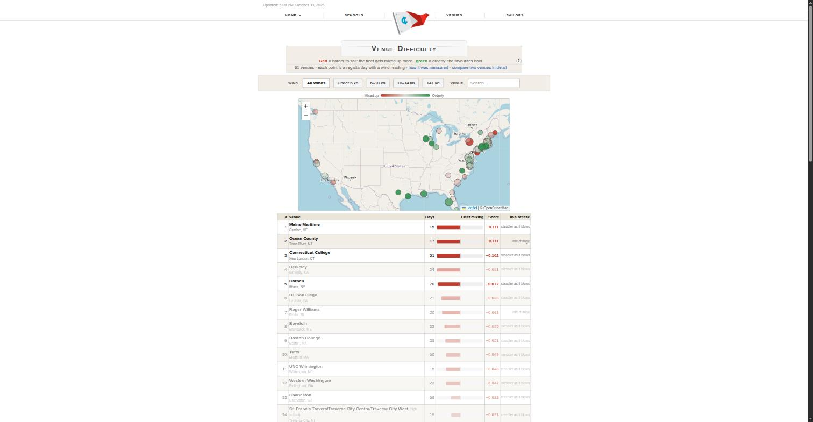
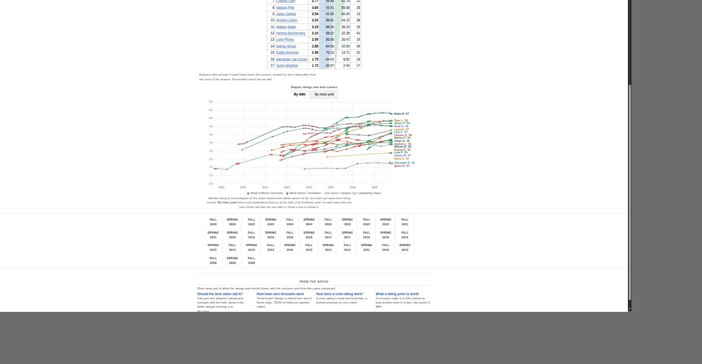

# Data-Driven Sailing

Ratings, forecasts and evaluation for U.S. college (ICSA) and high school (ISSA) sailing, from 1.5 million boat-race
results since 2008. Live at [datadrivensailing.com](https://datadrivensailing.com). Built and operated by one person
since 2025.

This repository is the public subset of the codebase: the rating trainer, the out-of-sample evaluator, the team race
framework, the scraper, the page generators and the tests. The scraped data, the SQLite databases, credentials and the
deploy scripts stay out of it, so the pipeline does not run end to end from a clean clone; the code is here to be read.

## What it looks like

| Venue difficulty: where fleets get mixed up | Every skipper on a team, over their careers |
|---|---|
|  |  |

Left: venues colored by how much results get scrambled there (red) versus how orderly they stay (green), filterable by wind band. Right: a team's skippers, one line each across their careers, switchable between calendar time and class year.


## Results (held out)

| Test | Site model | Static Plackett–Luce | Elo |
|---|---|---|---|
| Season-ahead pairwise accuracy, 4 seasons, 1.41 M pairs, 16,070 races | **70.4%** | 68.8% | 68.7% |
| Championships, ratings frozen the week before, 166 regattas | **72.4%** (95% CI 71.6–73.3) | | |
| Team race match forecast, spring 2025–26, 6,335 matches (log-loss) | **0.438**, 78.8% called | | |

The edge over Elo is +1.5 to +1.9 points (95% interval from resampling whole regattas). Every model is fit only on races
before each test season began; baseline settings are tuned on the season before that. Full write-up:
[datadrivensailing.com/icsa/methodology](https://datadrivensailing.com/icsa/methodology/).

## Architecture

```
Techscore (scores.collegesailing.org, scores.hssailing.org)
   │  scraper.py                 results, rosters, entries → CSV (resumable)
   ▼
SQLite x2                        build_db.py
   │
   ├─ analysis/plackett_luce/train_pl_weekly.py   weekly Plackett–Luce: θ[sailor, week], drift penalty,
   │                                                team pooling, newcomer prior; PyTorch on GPU
   ├─ analysis/plackett_luce/evaluate_models.py   season-ahead + championship tests vs Elo, static PL,
   │                                                average finish; regatta bootstrap; calibration
   ├─ analysis/plackett_luce/regatta_form.py      fitted regatta / drift / same-boat effects for simulations
   ├─ analysis/team_race/                         3v3 match model (model.py), forward evaluation (evaluate.py),
   │                                                production fit (fit.py), per-event orderliness, finish-set model
   ▼
generate_site.py, team_race_pages.py, notes_links.py, scripts/build_blog.py
   │  ~120,000 static pages, written only when content changed
   ▼
nightly systemd timer → checks → rsync changed pages → datadrivensailing.com
```

## Layout

- `analysis/plackett_luce/` — trainer, evaluator, preprocessing, newcomer prior, penalty model, regatta form, championship points.
- `analysis/team_race/` — match builder, Bradley–Terry side model, forward evaluation, fit, predictor, orderliness, finish-set model.
- `scraper.py`, `build_db.py` — collection and storage.
- `generate_site.py`, `team_race_pages.py`, `notes_links.py`, `auto_links.py`, `clean_links.py` — the ICSA site generator and its helpers.
- `event_kinds.py`, `disciplines.py`, `ranking_rules.py`, `womens_rules.py`, `freshman_rules.py`, `leading.py`, `performance_site.py` — rules the pages and forecasts share.
- `scripts/build_blog.py` — the notes; every number in the prose is computed, not typed.
- `scripts/render_engineering_page.py` — the engineering page.
- `tests/` — 138 of the project's 325 pytest tests; the rest need the local databases. `python -m pytest -q tests`
- `docs/DATA_DICTIONARY.md` — the tables and columns.

## Running what runs

```
pip install -r requirements.txt
python -m pytest -q tests
python analysis/plackett_luce/evaluate_models.py --help
```

The trainer and evaluator expect `data/` CSVs and the SQLite databases produced by `scraper.py` and `build_db.py`; see the
docstrings at the top of each file for the inputs and the protocol.

## Author

Quinn Brighton, Brown University (Applied Mathematics–Computer Science, 2027). [quinnbrighton2005@gmail.com](mailto:quinnbrighton2005@gmail.com)
